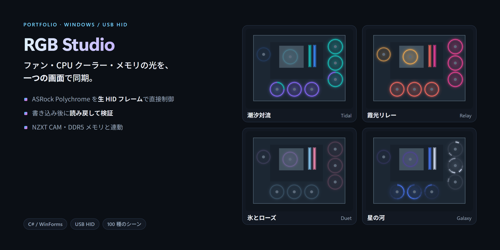

<p align="center"></p>

# RGB Studio

**One Windows app that switches case fans, the CPU cooler / motherboard ARGB and RAM lighting together, with 100 coordinated scenes.**

[日本語](README_JA.md) · [简体中文](README_CN.md) · [Русский](README_RU.md) · [Architecture](docs/architecture.md) · [Troubleshooting](docs/debugging_guide.md) · [Wiring](docs/hardware_wiring_guide.md)

[](LICENSE)


---

## What it controls, and what each part needs

RGB Studio drives three independent subsystems. Each one is optional: the app uses what it finds and
shows a status line for each part, so a PC with only some of this hardware still works.

| Part | How RGB Studio drives it | Needs |
| :--- | :--- | :--- |
| **CPU cooler / motherboard ARGB headers** | Raw 65-byte USB HID reports to the ASRock Polychrome controller, then reads every channel back to verify | ASRock board with controller **VID 26CE / PID 01A2**; `hidapi-hotplug.dll` from an OpenRGB install; ASRock Polychrome closed |
| **RAM sticks** (DDR4 / DDR5) | Puts every stick in Direct mode and streams frames from one clock thread over the OpenRGB SDK, so the sticks never drift apart | OpenRGB running as SDK server on `127.0.0.1:6743`; any number of sticks of any brand OpenRGB lists as DRAM |
| **Case fans on an NZXT hub** | Starts a tiny trigger exe; NZXT CAM's Profile Sync switches to the matching profile; RGB Studio confirms it in CAM's log | NZXT CAM, plus one-time profile setup with `scripts/setup_cam.py` |

Other motherboard vendors (ASUS, MSI, Gigabyte) are detected and named in the status line but **not driven**.

**Tested on:** ASRock B850 Challenger WiFi, NZXT Control Hub (3 zones), 2 × ADATA DDR5 (ENE, 8 LEDs each).
The paths without CAM, other stick counts and other DRAM brands are implemented and compile, but have not
been run on other hardware yet. Reports welcome.

---

## Setup

1. **Run** `release/RGB Studio.exe` (.NET Framework 4.5+, built into Windows 10/11). No installer.
2. **Cooler and RAM (optional):** install [OpenRGB](https://openrgb.org) 1.0+, then from an elevated PowerShell:
   ```powershell
   powershell -ExecutionPolicy Bypass -File scripts\register_openrgb_server.ps1 -OpenRGB "C:\Program Files\OpenRGB\OpenRGB.exe"
   ```
   This starts OpenRGB as a local SDK server at every logon. RGB Studio looks for `hidapi-hotplug.dll` next to
   itself, in `%OPENRGB_DIR%`, `C:\Program Files\OpenRGB` and `%LOCALAPPDATA%\Programs\OpenRGB`.
3. **Case fans via NZXT CAM (optional):** follow the 3 steps at the top of
   [`scripts/setup_cam.py`](scripts/setup_cam.py) (make one template profile in CAM, close CAM), then:
   ```powershell
   python scripts\setup_cam.py --list-channels   # which channel ids your hub has
   python scripts\setup_cam.py --channels 0,1,4  # dry run
   python scripts\setup_cam.py --channels 0,1,4 --write
   ```
   It backs up CAM's files, adds one profile per scene and writes `release/scenes.json` with their ids.

Without step 3, scenes change only the cooler and RAM; the fans are left alone. If CAM does not confirm a
fan switch within 25 s, the cooler and RAM are still applied and a warning says why.

## Build from source

```cmd
build.bat
```
Uses the C# 5 compiler that ships with .NET Framework (`csc.exe`), no SDK needed. Output: `release/RGB Studio.exe`.
`python scripts/build_triggers.py` rebuilds the trigger exes.

## How the hard parts work

* **Verified writes.** After each `0x10` write to a cooler channel, a `0x11` read must return the same mode, colour
  and speed, otherwise the status line says "读回不一致" (read-back mismatch). Replies left over from earlier
  requests are skipped by matching the channel number.
* **Conflict detection.** ASRock Polychrome polls the same controller and overwrites it; RGB Studio refuses to
  write while `AsrPolychromeRGB.exe` runs and tells you to close it.
* **RAM in sync.** The ENE chips on each stick keep their own time, so built-in effects drift apart within
  minutes. RGB Studio keeps the sticks in Direct mode and sends every frame (about 14 per second) from one
  clock, re-asserting Direct mode every 20 s because the flag is lost after sleep.
* **Colour.** Scene colours are sRGB picks; LEDs are linear. A gamma of 2.2 relative to the strongest channel
  keeps pastels from washing out to white.

## Acknowledgements

The ASRock Polychrome USB protocol and the SDK protocol come from [OpenRGB](https://gitlab.com/CalcProgrammer1/OpenRGB)
(GPL-2.0). RGB Studio contains no OpenRGB code; it talks to an OpenRGB install over its documented SDK.

## License

[MIT](LICENSE)
