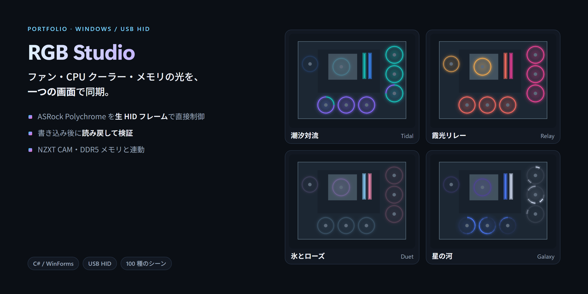

<p align="center"></p>

# RGB Studio

**一个 Windows 程序，用 100 套联动场景同时切换机箱风扇、CPU 散热器（主板 ARGB）和内存的灯光。**

[English](README.md) · [日本語](README_JA.md) · [Русский](README_RU.md) · [架构（英文）](docs/architecture.md) · [排错（英文）](docs/debugging_guide.md)


---

## 能控制什么，各自需要什么

三个部分互相独立，都是可选的：程序用它找到的部分，每部分单独显示状态，只有其中一部分硬件的电脑也能用。

| 部分 | 控制方式 | 需要 |
| :--- | :--- | :--- |
| **CPU 散热器 / 主板 ARGB** | 直接向华擎 Polychrome 控制器发送 65 字节 USB HID 报文，再逐通道读回校验 | 带 **VID 26CE / PID 01A2** 控制器的华擎主板；OpenRGB 自带的 `hidapi-hotplug.dll`；Polychrome 已退出 |
| **内存**（DDR4 / DDR5） | 所有内存条切到 Direct 模式，由一个时钟线程通过 OpenRGB SDK 推送每一帧，多条之间不会漂移 | 以 SDK 服务器方式运行在 `127.0.0.1:6743` 的 OpenRGB；条数、品牌不限（OpenRGB 识别为 DRAM 即可） |
| **NZXT 集线器上的机箱风扇** | 启动一个很小的触发程序，NZXT CAM 的 Profile Sync 切到对应配置，再从 CAM 日志确认 | NZXT CAM，以及用 `scripts/setup_cam.py` 做一次配置 |

华硕、微星、技嘉主板只识别并显示型号，**不控制**。

**实测环境：** 华擎 B850 Challenger WiFi、NZXT Control Hub（3 个区域）、威刚 DDR5 × 2（ENE 芯片，每条 8 颗灯）。
没有 CAM 的路径、非 2 条内存、其他品牌内存已经实现并通过编译，但还没在别的硬件上实机验证。

---

## 安装

1. 运行 `release/RGB Studio.exe`（需 .NET Framework 4.5+，Windows 10/11 自带），免安装。
2. **散热器和内存（可选）：** 安装 [OpenRGB](https://openrgb.org) 1.0+，然后在管理员 PowerShell 里：
   ```powershell
   powershell -ExecutionPolicy Bypass -File scripts\register_openrgb_server.ps1 -OpenRGB "C:\Program Files\OpenRGB\OpenRGB.exe"
   ```
   每次登录时会把 OpenRGB 作为本地 SDK 服务器启动。
3. **NZXT CAM 风扇（可选）：** 按 [`scripts/setup_cam.py`](scripts/setup_cam.py) 开头的 3 步（在 CAM 里建一个模板配置，关掉 CAM），然后：
   ```powershell
   python scripts\setup_cam.py --list-channels
   python scripts\setup_cam.py --channels 0,1,4          # 只预览
   python scripts\setup_cam.py --channels 0,1,4 --write  # 先备份 CAM 的文件再写入
   ```

不做第 3 步时，切换场景只改散热器和内存，不动风扇。CAM 在 25 秒内没确认风扇切换时，散热器和内存照常应用，并提示原因。

## 编译

```cmd
build.bat
```
只用 .NET Framework 自带的 `csc.exe`（C# 5），不需要 SDK。

## 技术要点

* **写入校验：** 每个散热器通道用 `0x10` 写入后，用 `0x11` 读回，模式、颜色、速度一致才算成功。
* **冲突检测：** Polychrome 会不停覆盖同一个控制器，它在运行时程序不写入，并提示先退出。
* **内存同步：** 每条内存上的 ENE 芯片用自己的时钟跑内置灯效，几分钟就会错开。改为 Direct 模式，由一个时钟每秒约 14 帧推给所有内存条；睡眠会丢失 Direct 设置，所以每 20 秒重发一次。
* **颜色：** 屏幕上选的 sRGB 颜色按 2.2 伽马换算成 LED 的线性亮度，浅色不会发白。

## 致谢

华擎 Polychrome USB 和 SDK 协议来自 [OpenRGB](https://gitlab.com/CalcProgrammer1/OpenRGB)（GPL-2.0）的分析。本项目不包含 OpenRGB 的代码，只通过它公开的 SDK 通信。

## 许可证

[MIT](LICENSE)
