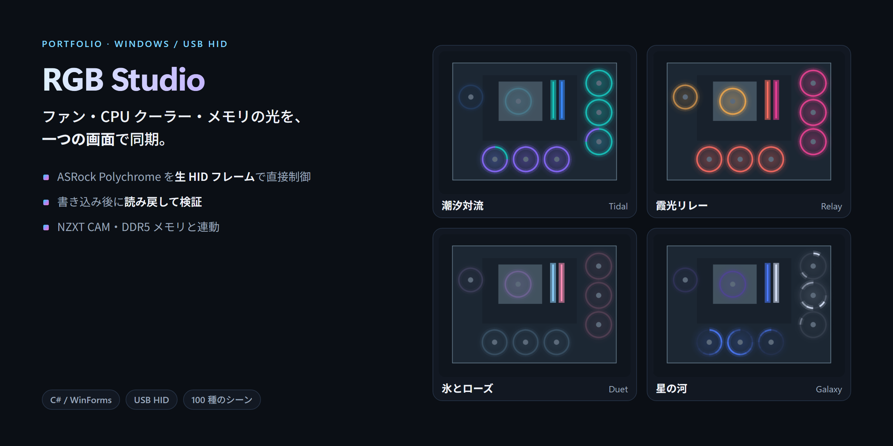

<p align="center"></p>

# RGB Studio

**ケースファン・CPU クーラー（マザーボード ARGB）・メモリの光を、100 種類のシーンでまとめて切り替える Windows アプリ。**

[English](README.md) · [简体中文](README_CN.md) · [Русский](README_RU.md) · [構成（英語）](docs/architecture.md) · [トラブル対応（英語）](docs/debugging_guide.md)


---

## 制御できるものと、それぞれの前提条件

3 つの系統はそれぞれ独立していて、どれも任意です。見つかったものだけを使い、系統ごとに状態を表示するので、
一部のハードしかない PC でも動きます。

| 対象 | 制御方法 | 必要なもの |
| :--- | :--- | :--- |
| **CPU クーラー / マザーボード ARGB** | ASRock Polychrome コントローラーへ 65 バイトの USB HID レポートを直接送り、全チャンネルを読み戻して確認 | コントローラー **VID 26CE / PID 01A2** を持つ ASRock 製マザーボード、OpenRGB 付属の `hidapi-hotplug.dll`、Polychrome を終了しておくこと |
| **メモリ**（DDR4 / DDR5） | 全モジュールを Direct モードにし、1 本の時計スレッドから OpenRGB SDK 経由でフレームを送るため、モジュール間でずれない | `127.0.0.1:6743` で SDK サーバーとして動く OpenRGB。本数・メーカーは問わない（OpenRGB が DRAM として認識するもの） |
| **NZXT ハブのケースファン** | 小さなトリガー exe を起動し、NZXT CAM の Profile Sync が対応プロファイルに切り替え、CAM のログで確認 | NZXT CAM と、`scripts/setup_cam.py` による初回のプロファイル作成 |

ASUS・MSI・Gigabyte のマザーボードは型番を表示するだけで、**制御はしません**。

**動作確認環境:** ASRock B850 Challenger WiFi、NZXT Control Hub（3 ゾーン）、ADATA DDR5 × 2（ENE、各 8 LED）。
CAM なしの経路、2 本以外の構成、他社メモリへの対応は実装済み・コンパイル確認済みですが、別のハードでの実機確認はまだです。

---

## セットアップ

1. `release/RGB Studio.exe` を起動（.NET Framework 4.5 以上、Windows 10/11 は標準搭載）。インストール不要。
2. **クーラーとメモリ（任意）:** [OpenRGB](https://openrgb.org) 1.0 以上を入れ、管理者 PowerShell で:
   ```powershell
   powershell -ExecutionPolicy Bypass -File scripts\register_openrgb_server.ps1 -OpenRGB "C:\Program Files\OpenRGB\OpenRGB.exe"
   ```
   ログオン時に OpenRGB をローカル SDK サーバーとして起動します。
3. **NZXT CAM のファン（任意）:** [`scripts/setup_cam.py`](scripts/setup_cam.py) 冒頭の 3 手順（CAM でテンプレートを 1 つ作り、CAM を終了）の後:
   ```powershell
   python scripts\setup_cam.py --list-channels
   python scripts\setup_cam.py --channels 0,1,4          # 確認のみ
   python scripts\setup_cam.py --channels 0,1,4 --write  # CAM のファイルをバックアップしてから追加
   ```

手順 3 を行わない場合、シーンはクーラーとメモリだけを切り替え、ファンには触れません。CAM が 25 秒以内に
切り替えを確認できなかった場合も、クーラーとメモリは適用し、理由を表示します。

## ビルド

```cmd
build.bat
```
.NET Framework 付属の `csc.exe`（C# 5）だけで、SDK は不要です。

## 技術的なポイント

* **書き込みの検証:** クーラーの各チャンネルに `0x10` で書いた後、`0x11` で読み戻してモード・色・速度が一致するか確認します。
* **競合の検出:** Polychrome は同じコントローラーを上書きし続けるため、起動中は書き込まずに終了を促します。
* **メモリの同期:** 各モジュールの ENE チップは内蔵エフェクトを独自の時計で動かすため、数分でずれます。
  Direct モードで 1 つの時計から毎秒約 14 フレームを全モジュールへ送り、スリープで失われる Direct 設定は 20 秒ごとに再送します。
* **色:** 画面で選んだ sRGB 色を LED の線形な明るさへガンマ 2.2 で補正し、淡い色が白飛びしないようにしています。

## 謝辞

ASRock Polychrome USB と SDK のプロトコルは [OpenRGB](https://gitlab.com/CalcProgrammer1/OpenRGB)（GPL-2.0）の解析に基づきます。
RGB Studio は OpenRGB のコードを含まず、公開 SDK 経由で通信します。

## ライセンス

[MIT](LICENSE)
