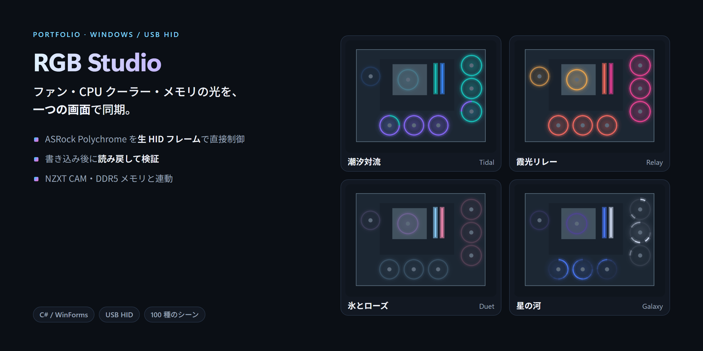

# RGB Studio

**Приложение для Windows, которое одновременно переключает подсветку корпусных вентиляторов, кулера (ARGB материнской платы) и оперативной памяти — 100 согласованных сцен.**

[English](README.md) · [日本語](README_JA.md) · [简体中文](README_CN.md)

| Часть | Как управляется | Что нужно |
| :--- | :--- | :--- |
| Кулер / ARGB платы | USB HID-отчёты контроллеру ASRock Polychrome с проверкой обратным чтением | Плата ASRock с контроллером VID 26CE / PID 01A2, `hidapi-hotplug.dll` из OpenRGB, закрытый Polychrome |
| Память DDR4 / DDR5 | Режим Direct, кадры из одного таймера через OpenRGB SDK — модули не расходятся | OpenRGB как SDK-сервер на `127.0.0.1:6743`; любое число модулей |
| Вентиляторы на хабе NZXT | Запуск маленького exe-триггера, NZXT CAM переключает профиль | NZXT CAM и однократная настройка `scripts/setup_cam.py` |

Каждая часть необязательна. Платы ASUS, MSI и Gigabyte только распознаются, но не управляются.
Проверено на ASRock B850 Challenger WiFi, NZXT Control Hub и 2 × ADATA DDR5.

Установка и подробности: [README.md](README.md) (на английском).

Лицензия: [MIT](LICENSE).
